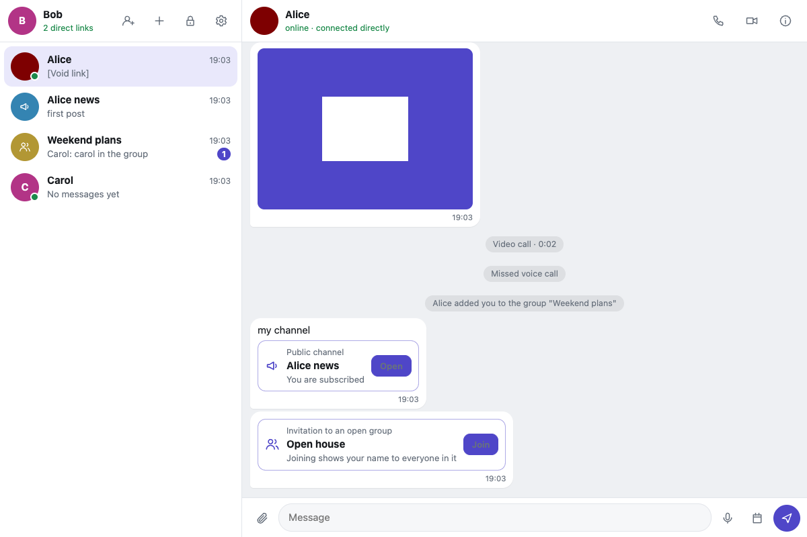
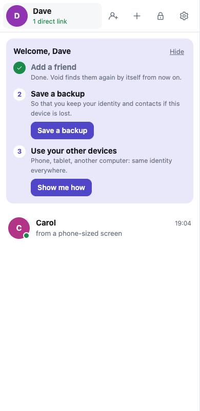

# Void

A peer-to-peer messenger that is a single HTML file. Open it in a browser and it runs: nothing to install, no account, no server behind it. Browsers connect to each other over WebRTC and relay for one another, so the network is simply the people using it.



> **Status: experimental.** Void works end to end in its automated tests. It has had no outside security audit, and it has not yet been tried on real phones or between two real home networks. Don't trust it with anything that matters, and read the [limits](#limits) first.

## Get it

Download `void.html` from the [latest release](../../releases/latest) and open it. That file is the whole application. You can also [build it yourself](#building-and-testing).

## First steps

1. Open `void.html`, choose a name and a password.
2. Click **Add a friend** (the person icon), copy the invite link and send it however you like. You can close the dialog afterwards.
3. Your friend opens their own copy of the file, chooses **Add a friend › They invited me** and pastes the link. You become contacts the next time you are both online. They have nothing to send back.

To try it alone, open the file a second time with `?profile=bob` at the end of the address. Each profile is a separate identity.

Copies of the file that speak different protocol versions refuse to connect, and say so.

## What it can do

- One-to-one chats, private groups, open groups joined by link, and channels where only the owner posts
- Files, images and voice messages; edits and deletions; send later; messages that delete themselves after a set time
- Voice calls, video calls and screen sharing between two contacts
- Profile photos, your own names for contacts, mute, block, export of a conversation
- Several devices for one identity, through a passphrase-protected backup file
- Everything kept on the device is encrypted with your password
- A contact you cannot reach directly is reached through mutual contacts, over up to six hops, still end-to-end encrypted. When a direct connection becomes possible the conversation moves to it
- Messages for someone who is offline wait with mutual contacts for up to a week
- An *Advanced* tab on every conversation lists what your device knows about it: ids, public keys, routes, network addresses

Not there yet: group calls, reactions, read receipts, search.

## How it works

Void is a friend-to-friend network. A device only ever connects to its user's contacts.

When two contacts have no direct connection, one of them asks its own contacts for a route. The request carries an opaque 16-byte tag and travels at most six hops; the answer leaves a tunnel behind on its way back. The devices in between forward sealed frames and learn neither who is talking nor what is said. Once the tunnel is up, the two ends use it to negotiate a direct WebRTC connection, and drop the tunnel if that succeeds.

A conversation is a set of append-only logs of signed events, one log per device. Devices that share a conversation compare what they hold and send each other what is missing. That is how groups and channels spread from member to member without a server.

The wire format is specified in [PROTOCOL.md](PROTOCOL.md).

## The two public helpers

A web page cannot listen for incoming connections, cannot find out its own public address, and cannot call a contact back after a restart. Native programs lean on outside infrastructure for the same reasons (RetroShare finds its friends through the BitTorrent DHT). Void uses two kinds of public services run by third parties. Both are on by default, and each has a switch under **Settings › Network**.

| Helper | Used for | Sees | Never sees |
| --- | --- | --- | --- |
| STUN servers | Learning your public address, so that devices on different networks can connect | Your IP address | Anything else |
| Rendezvous relays (public Nostr relays) | Invite links, and finding your contacts again after a restart | Your IP address, an opaque topic that changes every day, small sealed notes | Messages, names, user ids, contact lists |

Neither carries messages. With both switched off, the page talks to your contacts' devices and to nothing else: the Content-Security-Policy forbids every HTTP request in any case, and the browser test checks that no socket is opened. Direct connections then only work inside one local network, and after a restart you reconnect by exchanging a pair of one-time codes with one contact who is online. Everyone reachable through that contact follows automatically.

## Security

**Keys.** Identities are Ed448 keys and key agreement uses X448, about 224 bits of security. Symmetric keys are 256 bits (XChaCha20-Poly1305, ChaCha20-Poly1305, AES-256-GCM) and are derived with HKDF-SHA512.

**Connections.** Every connection, direct or relayed, proves who is at the other end and takes its one-time keys from two key exchanges combined: X448 and ML-KEM-1024. Recorded traffic cannot be opened later with the long-term keys, and opening it at all means breaking both exchanges, the second of which is designed to hold against quantum computers.

**Messages.** Every event is signed by its author and encrypted with a key that only the members of the conversation hold. Removing someone from a private group changes the key.

**Calls.** Sound and picture go straight from one device to the other. Each frame is encrypted with AES-256-GCM under keys agreed inside the conversation, then encrypted again by WebRTC (DTLS-SRTP). A browser that cannot do the first layer falls back to the second one alone, and the call screen says which you have.

**On disk.** Everything is sealed with a key derived from your password (scrypt, 128 MiB of memory per guess), and record names are replaced by keyed hashes. Without the password nothing loads, and there is no way to recover it.

What this does not protect against:

- A computer that is compromised while Void is unlocked. Malware, a browser extension or someone at the developer tools can read whatever you can read.
- A tampered file. The HTML file is the whole application, so get it from a place you trust. Opened from your disk it is the file you checked; loaded from a web address, whoever controls that address can change it.
- Your IP address being seen by the contacts you connect to directly and by the two public helpers. The per-contact option *Never connect directly* hides it from one contact, at the price of always going through mutual contacts, and of not being able to call them.
- Messages waiting with mutual contacts for someone offline. They are sealed with the conversation key, which is long-lived; there is no ratchet yet. Someone who obtains that held mail, and later the keys of one of the two devices, can read it.
- The post-quantum exchange covers connections only. Signatures, held mail and the notes left on rendezvous relays still rest on Curve448 alone. The ML-KEM library has not been independently audited, which is why it is never used without X448 next to it.
- Deleting a message is a request. A device that already received it can keep it.

What relays and neighbours can observe, and the other known gaps, are listed in [section 17 of PROTOCOL.md](PROTOCOL.md#17-security-properties-and-known-gaps).

The primitives come from the [noble](https://paulmillr.com/noble/) libraries and from the browser's WebCrypto. The way they are put together here is new and has not been reviewed by anyone outside the project. To report a problem, see [SECURITY.md](SECURITY.md).

## Limits

- The page has to be open. A closed tab receives nothing and relays nothing; messages wait with mutual contacts until you are back.
- Some pairs of networks cannot connect directly even with STUN, mobile carriers in particular. They stay relayed through contacts that both can reach, and cannot talk at all if there is none.
- Two admins changing a group's member list at the same moment can leave devices disagreeing about it.
- One tab per identity. A second tab on the same profile is refused.
- Clearing the browser's site data erases the profile. Keep a backup file.
- A forgotten password cannot be recovered.

## Phones, tablets, TVs



On a computer, double-click the file or drag it into Chrome, Firefox, Edge or Safari.

On Android, open it from a file manager with Chrome or Firefox.

Safari on iPhone and iPad does not run local HTML files. Serve the file from a computer on the same network (`python3 -m http.server`, then open `http://<that computer>:8000/void.html`), or put it on any static web host. The same goes for TVs and anything else with a browser. Over plain `http://` browsers withhold the camera and the microphone, so calls, QR scanning and voice messages are missing there.

So far only desktop Chrome, Firefox and a WebKit test build have been exercised. Phones are untested.

<br clear="right">

## Building and testing

```
npm install
npm run build          # writes dist/void.html
npm test               # the engine on a simulated network
npm run test:browser   # the built file in Chrome (needs Google Chrome installed)
npm run test:interop   # pairs of Chrome, Firefox and WebKit (npx playwright-core install firefox webkit)
```

The engine in `src/core/` has no DOM or WebRTC dependency and runs under Node. The unit tests start several nodes on a simulated network and cover multi-hop relaying, the switch to a direct connection, offline delivery, group key renewal, forged and replayed traffic, tampering with either half of the key exchange, and the storage vault.

The browser test opens the built file in several Chrome profiles with real WebRTC. It goes through pairing, relaying through a third profile, a video call with screen sharing, a raw read of the browser storage, and locking, and it checks that with both helpers off the page makes no request and opens no socket.

In the interop run, WebKit with WebKit fails: Playwright's WebKit build cannot resolve the `.local` names browsers use in place of LAN addresses. Real Safari has not been tried.

| Path | Content |
| --- | --- |
| `src/core/` | Protocol engine, storage vault, rendezvous logic |
| `src/net/` | WebRTC transport, client for the rendezvous relays |
| `src/ui/` | The interface |
| `build.mjs` | Bundles everything into one HTML file with a strict Content-Security-Policy |
| `test/unit/` | Engine tests and the simulated network |
| `test/browser/` | End-to-end tests in real browsers |

Issues and pull requests are welcome. For a change to the protocol, please open an issue first.

## Background

The friend-to-friend topology and the tunnels through friends of friends follow [RetroShare](https://retroshare.cc/), which has been doing this for years as a native program. The per-device logs are close to Secure Scuttlebutt's feeds. Nostr relays are used as a rendezvous notice board and nothing more. Void shares no code with these projects and is not compatible with their networks.

## License

[GNU Affero General Public License, version 3 or later](LICENSE). The bundled libraries keep their own licenses, listed in [THIRD-PARTY-NOTICES.md](THIRD-PARTY-NOTICES.md).
